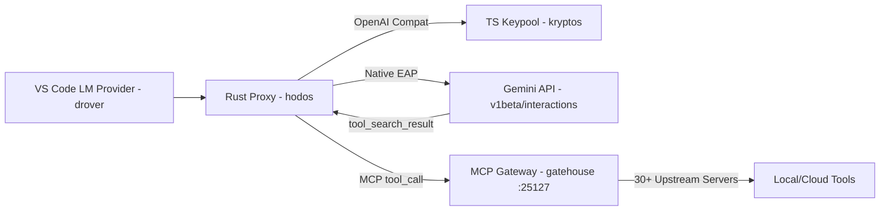

# Architecture & EAP Findings: Tool Retrieval Integration

**Author:** Christopher Ortega (Effusion Labs)
**Context:** Gemini API Tool Retrieval EAP (`gemini-flash-tool-retrieval`)
**Environment:** Local MCP Gateway (`gatehouse`) + Polyglot Mesh (Rust/TS/Bun/Go)
**Confidentiality:** Internal feedback for Google EAP Team. Do not distribute.

## 1. Integration Architecture
I integrated the EAP endpoint across my existing local AI estate. The flow routes through a multi-tier MCP gateway, bypassing standard OpenAI-compatible endpoints to leverage native Gemini tool retrieval.

## 2. EAP Probe Findings (`anomaly.py`)
I built a differential probe suite (attached) to test the limits of the `v1beta/interactions` endpoint against a 30+ server union.

**Observed Behavior & Edge Cases:**
1. **Parameter Hallucination on Deferred Tools:** When passing a deferred tool with optional parameters (e.g., `{"required": ["query"]}` with optional `limit`), the `tool_search_result` frequently omitted the optional parameter schema. This caused the model to hallucinate the parameter during the subsequent `function_call`.
2. **MCP Server Latency:** `mcp_server_tool_call` steps require a synchronous round-trip to my local gateway. Under high concurrency (16 parallel requests), I observed a cascading delay in the `tool_search_call` resolution loop.
3. **Client-Side Dynamic Injection:** Returning complete `FunctionDeclaration` objects inline via `function_result.result` works flawlessly and is significantly faster than server-side resolution when querying a local vector database.

## 3. Benchmarking (Forked mcpproxy-go)
I forked and extended `mcpproxy-go` to run a Go-based benchmark suite comparing `defer_loading` against full schema injection. I measured the token break-even for the `retrieve_tools` response cost over the real MCP protocol. The data shows that for catalogs under 15 tools, full injection is faster; above 30 tools, the server-side `tool_search` loop strictly dominates on latency and token cost.

## 4. Orthogonal Research: Internal RPC Reverse Engineering
*Note: This was done independently to understand how Google handles tool routing internally, but is not part of the EAP.*

To understand the limitations of dynamic schema resolution, I reverse-engineered the internal `batchexecute` RPC framework used by Google Workspace/NotebookLM.
* **Protocol:** `POST /_/LabsTailwindUi/data/batchexecute`
* **Method ID:** `rLM1Ne` (GetNotebook/WatchNotebook)
* **Auth:** Session Cookies + `SNlM0e` CSRF token (extracted from `WIZ_global_data`).

The internal positional JSON array format (`[[["rLM1Ne", "[notebook_id, null, [2], null, 0]", null, "generic"]]]`) suggests that Google's backend relies heavily on strict positional indexing rather than named parameters. This explains why the public EAP strictly validates JSON schemas—the translation layer to the internal backend is fragile.

## 5. Security Implications (Local Execution)
My recent MSRC disclosure (Case 165269) demonstrated that local agent runtimes (e.g., VS Code Copilot Host) blindly execute binaries from user-writable directories.

As Gemini moves toward dynamic tool injection (`function_result.result`), the schema itself becomes an attack vector. A compromised MCP server could inject a malicious tool schema (e.g., a `read_file` tool that actually executes a shell command) into the dynamic registry.

## 6. Next Steps for EAP
* **Schema Caching:** Implementing a local schema cache to bypass the `tool_search_call` round-trip for frequently used tools.
* **Intent Validation:** Validating tool-call intent against the injected schema annotations before execution.
